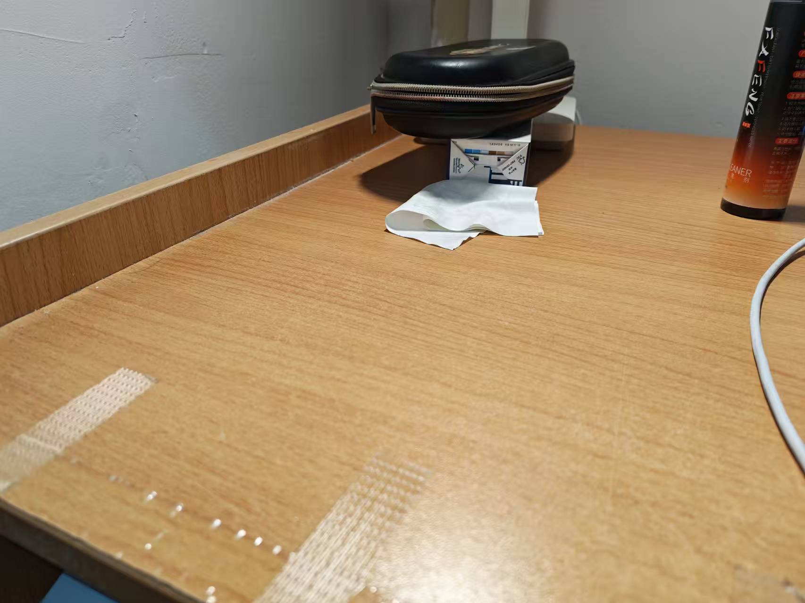
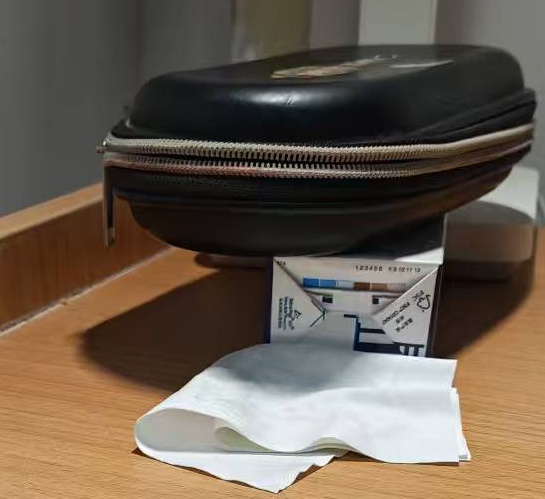
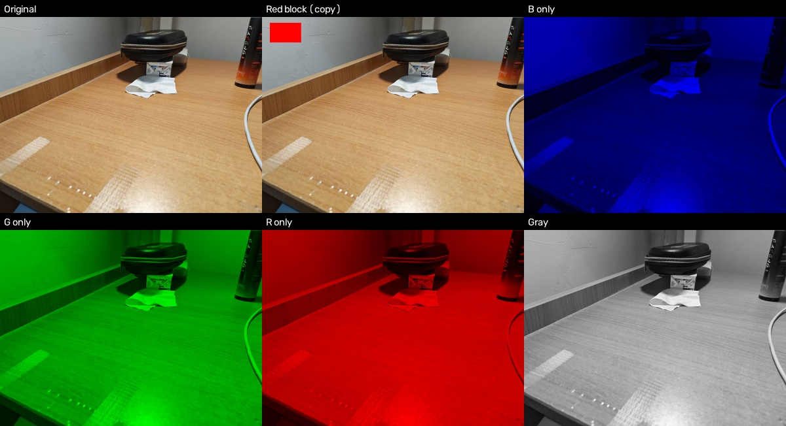
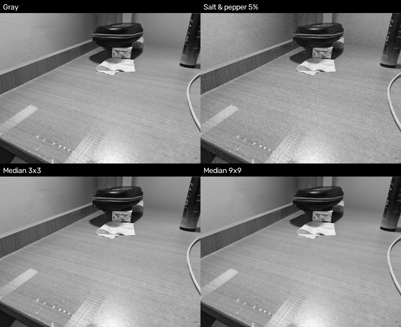
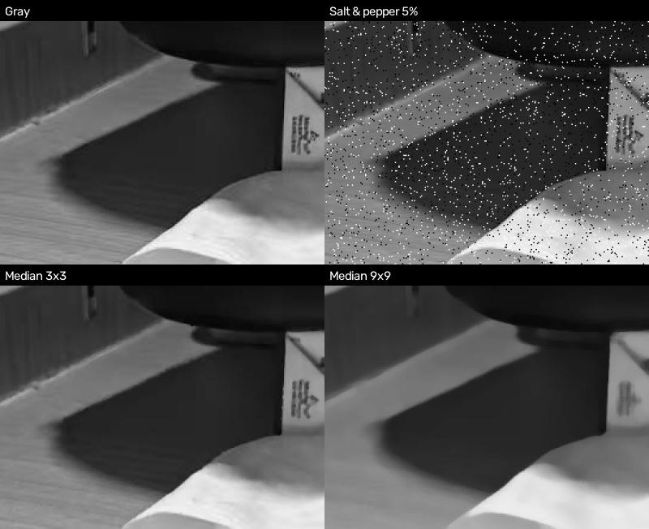
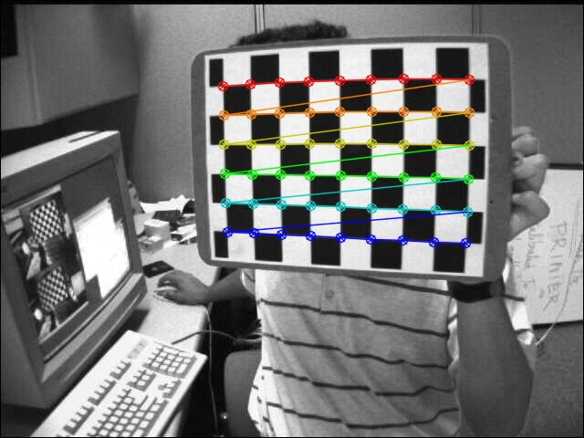
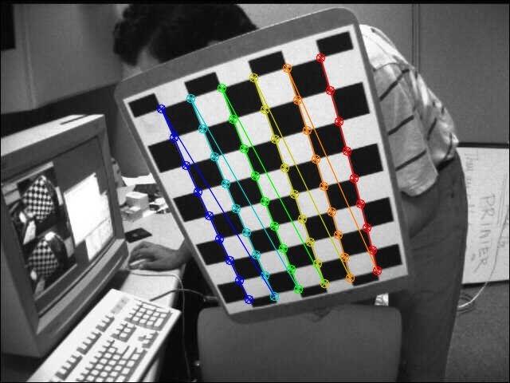
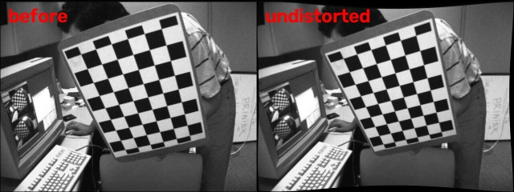

# vision

用摄像头拍一张照片，再用 NumPy 和 OpenCV 改写它的像素、颜色和清晰度，最后用棋盘图做一次相机标定。

## 环境

| 项目 | 值 |
| --- | --- |
| 操作系统 | Windows 11 家庭版 |
| 环境工具 | uv（管理 Python 3.12 与 `.venv`） |
| 关键依赖 | numpy 2.5.5、opencv-python 5.0.0.93 |

```powershell
python -m uv venv --python 3.12 .venv
python -m uv pip install --python .venv\Scripts\python.exe numpy opencv-python
```

运行命令（在仓库根目录执行）：

```powershell
.venv\Scripts\python.exe src\capture_photo.py     # 拍照：s 保存，q 退出
.venv\Scripts\python.exe src\image_array_ops.py   # 像素、切片、通道
.venv\Scripts\python.exe src\filtering.py         # 椒盐噪声与中值滤波
.venv\Scripts\python.exe src\calibrate_camera.py  # 棋盘角点与相机标定
```

`src/capture_photo.py` 默认打开 0 号摄像头（`--camera 1` 可换），加 `--auto` 则自动保存一张后退出。

## 一、拍照

`cv2.VideoCapture` 打开摄像头实时预览，按 `s` 把当前帧写入 `data/photo.jpg`，按 `q` 直接退出；两种退出方式都会 `release()` 摄像头并 `destroyAllWindows()`。打开失败或读帧失败会打印提示。

```python
cap = cv2.VideoCapture(0, cv2.CAP_DSHOW)
if not cap.isOpened():
    print("打开摄像头失败")
...
ok, frame = cap.read()
cv2.imshow("camera | s: save  q: quit", frame)
if cv2.waitKey(1) & 0xFF == ord("s"):
    imwrite(PHOTO, frame)
```



> 本仓库这张 `data/photo.jpg` 用手机拍摄（1706×1280），下面所有处理脚本都不依赖分辨率；同一套代码也能直接处理 `src/capture_photo.py` 拍出的电脑摄像头照片。

## 二、数组与通道操作

```text
shape = (1280, 1706, 3)  dtype = uint8 -> 高 1280, 宽 1706, 通道 3
像素 (u=853, v=640)：img[640, 853] = [116 168 205]
```

- 单像素：`(u, v) = (853, 640)`，即 `img[640, 853]`，打印结果按 **B、G、R** 排列。
- 裁剪：`img[38:537, 682:1227]`，即 `x=682, y=38, 546×499` → `results/crop.jpg`。
- 副本改色：`img.copy()` 后把 `img[38:166, 51:255]` 整块设为红色 `(0, 0, 255)` → `results/recolored.jpg`。
- 通道：用 `np.zeros_like` 复制形状，只填一个通道，得到仅 B / 仅 G / 仅 R 三张彩色图；灰度图由 `cv2.cvtColor(img, cv2.COLOR_BGR2GRAY)` 得到，`(1280, 1706)`，比彩色图少一个通道维。

坐标都写成相对比例（`src/image_array_ops.py` 顶部的 `PIXEL`、`CROP`、`BLOCK`），换任何尺寸的照片都不用改代码。





**简答：** OpenCV 彩色图像的三个通道按 **B、G、R**（蓝、绿、红）排列，不是 RGB。所以“红色”要写成 `(0, 0, 255)`，而 `img[:, :, 0]` 取到的是蓝色分量。

## 三、滤波：去掉椒盐噪声

在灰度图副本上随机挑 **5%** 的像素，一半置 0（黑）、一半置 255（白），随机种子固定为 `42`，重复运行结果一致；再用 `3×3` 和 `9×9` 的中值滤波核处理。放大区域为 `x=716, y=256` 的 272×204 小块，放大 2 倍便于观察。





**简答：** 核从 `3×3` 增大到 `9×9` 后噪点去得更干净，但窗口内参与取中值的像素更多，边缘、纹理和细节被一起抹平，图像明显变糊。

## 四、用棋盘图标定相机

`data/calibration/` 中是 OpenCV 官方样例的 `left01`–`left14`（仓库里没有 `left10.jpg`，共 13 张），只使用 `left*.jpg`，未混入 `right*.jpg`。

- 棋盘内角点为 **9×6**（不是方格数 8×7）：`cv2.findChessboardCorners` 检测，`cv2.cornerSubPix` 优化。
- **13/13 张全部检测成功**，每张 54 个角点，只用这些图参与标定；角点标注图见 `results/corners_left*.jpg`。
- 三维点用 `np.mgrid` 生成，`Z=0`，角点间距 1 个“棋盘单位”；图像尺寸按 `(宽, 高) = (640, 480)` 传入。




内参矩阵：

```text
[[536.073  0.000  342.370]
 [  0.000  536.016 235.537]
 [  0.000  0.000   1.000]]
```

畸变系数（k1, k2, p1, p2, k3）：

```text
[-0.26509  -0.04674  0.00183  -0.00031  0.25231]
```

RMS 重投影误差：**0.4087 像素**。参数存为 `results/camera_params.npz`（`camera_matrix`、`dist_coeffs`、`image_size`）。

`cv2.undistort` 对 `left13.jpg` 去畸变的前后对比：



**简答：** `fx、fy` 是以像素为单位的焦距（x、y 两个方向，通常很接近），`cx、cy` 是主点坐标，即光轴与成像平面交点落在图像上的像素位置，理想情况接近图像中心。

> 这些参数属于这组棋盘图对应的相机，不能直接用于本机摄像头的准确校正；本题也不使用棋盘尺度换算真实米制距离。

## 目录结构

```text
vision/
├── README.md
├── .gitignore
├── src/
│   ├── capture_photo.py     # 摄像头拍照
│   ├── image_array_ops.py   # 像素、切片、通道
│   ├── filtering.py         # 椒盐噪声与中值滤波
│   └── calibrate_camera.py  # 角点检测、标定、去畸变
├── data/
│   ├── photo.jpg
│   └── calibration/         # left01–left14
└── results/                 # 对比图、角点图、camera_params.npz
```
